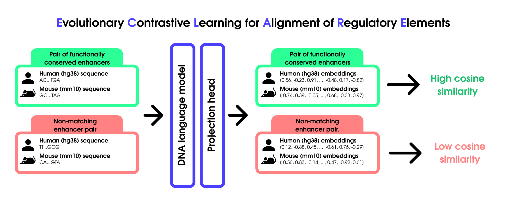

# Eclare

<p align="center">
  
</p>

<p align="center">
  <b>Evolutionary Contrastive Learning for Alignment of Regulatory Elements</b>
</p>

## О проекте

**Eclare** — исследовательский проект по обучению общих представлений для регуляторных элементов генома разных видов.

Основная идея — использовать эволюционно связанные энхансеры как положительные пары в контрастивном обучении. Последовательности человека и мыши кодируются DNA language model, после чего небольшая projection head обучается сближать представления функционально соответствующих энхансеров и разделять несвязанные пары.

В отличие от прямого сравнения нуклеотидных последовательностей, Eclare исследует возможность выравнивать регуляторные элементы в пространстве признаков, сохраняя их функциональное сходство даже при значительном расхождении последовательностей.

<p align="center">
  <i>sequence → DNA language model → shared regulatory embedding space</i>
</p>

## Статус

Проект находится на ранней исследовательской стадии. Сейчас формируется первый воспроизводимый пайплайн для построения межвидового датасета энхансеров и обучения базовой контрастивной модели.

## SCREEN metadata

`eclare.data.screen` загружает ELS-пары и biosample-specific метаданные через
GraphQL. `load_orthologous_els` использует пятую колонку SCREEN BED (`EH38E…` /
`EM10E…`); связи one-to-many сохраняются, точные дубликаты пар удаляются.
`fetch_ccres` возвращает сырые записи, `parse_zscores` выбирает колонки,
`fetch_ccre_metadata` сразу возвращает DataFrame для одного вида,
`fetch_human_mouse_metadata` возвращает `pairs, human_meta, mouse_meta`.

```python
from eclare.data.screen import fetch_human_mouse_metadata, enrich_ccre_metadata

fields = ["tissue", "sample_type", "life_stage", "assay", "zscore"]
pairs, human_meta, mouse_meta = fetch_human_mouse_metadata(
    "hg38-mm10-Homologous.tsv", "GRCh38-cCREs.ELS.bed", "mm10-cCREs.ELS.bed",
    fields=fields, batch_size=200,
)
pairs.to_parquet("orthologous_els.parquet", index=False)
human_meta.to_parquet("human_metadata.parquet", index=False)
mouse_meta.to_parquet("mouse_metadata.parquet", index=False)
```

Поддерживаются `ccre_id`, `ccre_group`, `biosample`, `display_name`, `tissue`,
`sample_type`, `life_stage`, `assay`, `zscore`, `tf`, `experiment_accession`,
`file_accession`. `ccre_id` добавляется автоматически; без `fields` возвращаются
все эти колонки. `tissue` соответствует SCREEN `ontology`.
`include_biosample_details=true` используется только при запросе `display_name`,
`tissue`, `sample_type` или `life_stage`. Позиции полей в ответе без details
сохраняются: вместо этих значений приходят `null`
([формат SCREEN](https://github.com/weng-lab/SCREEN2.0/blob/b256bde1dcfba45aad50fc255459d911be75e63e/screen2.0/src/common/lib/zscores.ts#L3-L21)).

Позже можно добавить поля или новые IDs, не заменяя существующие значения:

```python
import pandas as pd

human_meta = pd.read_parquet("human_metadata.parquet")
human_meta = enrich_ccre_metadata(
    human_meta, pairs["human_id"].unique(), assembly="grch38",
    fields=[*fields, "display_name"],
)
human_meta.to_parquet("human_metadata.parquet", index=False)
```

Покрытие определяется по колонкам и обработанным IDs, а не по `NaN`.
`DataFrame.attrs["screen"]` хранит покрытие по полям, включая cCRE без Z-score
строк, assembly и ключи измерений. Эти атрибуты сохраняются при pandas/pyarrow
Parquet round-trip; для дополнения передавайте исходную таблицу без перестановки
или фильтрации строк. Таблицы без атрибутов тоже принимаются: колонки считаются
полученными для присутствующих IDs, а строки должны однозначно сопоставляться
по видимым ключам измерений. Неоднозначное сопоставление или изменение набора
измерений между запросами приводит к явной ошибке.

Установка зависимостей: `python -m pip install -r requirements.txt`.
Короткий E2E-пример с минимальным набором полей и экспортом Parquet:
[notebooks/screen_metadata.ipynb](notebooks/screen_metadata.ipynb).
Ключ задаётся через `SCREEN_API_KEY` или аргумент `api_key`; инструкции —
[SCREEN API Console](https://console.wenglab.org/docs/getting-started/auth).

Батч по умолчанию — 200 IDs, timeout — 60 секунд, до трёх повторных попыток
при сетевых ошибках/HTTP 408, 429, 5xx с exponential backoff.
Для продолжения после сбоя повторите вызов: успешные ответы уже сохранены в
`.screen_cache/` и используются даже при изменении размера батча или набора IDs.
Старые checkpoint’ы читаются без миграции. Ответ с biosample details подходит и
для запроса без details, но не наоборот; при дополнении поля могут быть извлечены
из кеша вообще без сети. Кеш учитывает endpoint, assembly и запрос.
`cache_dir=None` отключает его. Bulk Z-score matrices не используются.
